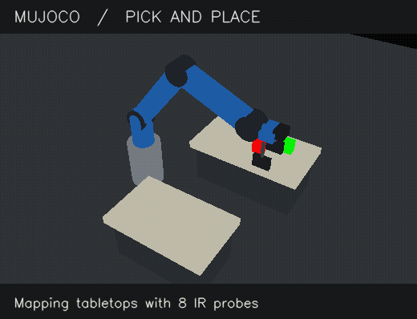

# Camera-guided pick and place with sparse infrared ranging

Give the arm a command such as `green 80 80` and it must find the green block, lift it, and place its centre 80 mm along each axis of the destination table. Each episode changes the table dimensions and the blocks’ starting positions. The controller has to measure the workspace before it can interpret the command.

This six-axis arm runs in MuJoCo with a ROS 2 Humble controller. Across three fresh simulation layouts, it transferred **9 of 9 blocks** with a **mean placement error of 8.6 mm**. All nine came to rest fully on the destination table. The largest miss from the requested point was **12.4 mm**. [Per-seed results and trial conditions](VALIDATION.md)

*Sped-up MuJoCo run for `green 80 80`. The final caption shows the measured distance from the requested point to the settled block centre.*

## How the arm finds a point on the table

1. **Find the boundaries.** From a parked pose, the calibrated overhead RGB camera captures both tables. OpenCV extracts their four-corner outlines and locates the coloured blocks inside them.
2. **Measure the surfaces.** The arm visits four spaced positions above each table. Wrist infrared ranges let it fit a plane to each surface. Intersecting the camera rays through the outline corners with those planes gives table dimensions and a coordinate frame in metres.
3. **Plan and transfer.** The controller converts the requested table coordinates into a tool position, checks clearance and reach, and solves the joint poses. The parallel jaws close on the block. Both fingers must register contact at the grasp checks before the transfer continues.
4. **Score the result independently.** After withdrawal, the simulator checks support, footprint and settling, then measures the block centre from the **true** destination corner. This exposes errors that would cancel out if the scorer reused the controller’s scanned corner.

## Problems encountered and what the measurements showed

| Observed problem | Diagnosis and outcome |
|---|---|
| The arm stayed parked although both tables were visible. | Native OpenGL lighting turned much of each tabletop nearly white. The original colour mask discarded these pixels, leaving fragments that failed the rectangular-outline check. Including bright, low-saturation pixels restored both outlines in the captured image. A live ROS run then completed all eight probe positions. |
| The fingers closed around blue, but the lift never started. | On a replay of seed `497922811`, both fingers contacted the source table and neither contacted the block at closure. Raising the grasp and release references by 8 mm cleared the jaws. On the same layout, both fingers held blue after lift and all three blocks transferred. |
| Successful transfers landed beyond the requested X coordinate. | Across nine placements, the gripper averaged 3.8 mm past the target in X before opening. The held block centre was already another 4.8 mm along X. Mean planar movement from opening to settling was only 0.4 mm. When the block first acquires that offset remains an open question. |

The placement trials used MuJoCo contact dynamics, a software-rendered mapping image and in-process controller messages. The camera calibration and block height were known, and both rectangular tabletops were visible against a contrasting background. [Recorded grasp and placement events](evidence/grasp_height_trials/)

## Future scope

- **Locate the source of the grasp offset.** Measure block position relative to the jaws at closure, immediately after lift and just before release. This would distinguish an initially off-centre grasp from movement during transport.
- **Quantify the value of wrist ranging.** Compare camera-only mapping at an assumed table height with the eight-position IR method on identical layouts. Vary table heights and introduce an unknown camera tilt. Measure corner error, mapping time and settled placement error.
- **Test precision across a larger workspace sample.** Rotate colours between near and far targets on held-out seeds. Report failed grasps alongside the fraction of all requests that settle within a proposed 5 mm radius. The current nine trials establish a baseline for that comparison.

## Run on macOS with ROS 2 Humble

Use a Python environment containing ROS 2 Humble and colcon. Run these commands
from the repository root. The macOS viewer uses MuJoCo’s `mjpython` executable.

~~~zsh
conda activate ros2_env
source "$CONDA_PREFIX/setup.zsh"
python -m pip install -r requirements.txt
python tools/check_environment.py
colcon build --symlink-install
source install/setup.zsh
ros2 launch colour_sorting_arm demo.launch.py viewer:=true
~~~

In a second terminal, activate and source the same environment and workspace, then
run `ros2 run colour_sorting_arm targets`. After the launch terminal reports
`Camera-edge map ready`, enter commands at the prompt.

~~~text
green 80 80
red 185 145
blue 280 75
~~~

Each pair specifies the block centre in millimetres from the destination corner
nearest the base. X runs along the long edge away from the base, Y along the
short edge towards world −Y. The planner checks reach, edge clearance and
occupancy. A colour alone selects a free slot. Use `standard` for the three
commands above, `rescan` while idle to refresh the map, or `next` to abandon
an episode. Three verified transfers start a new random layout. Add `seed:=7`
to the launch command for a repeatable first layout.

The launch terminal reports true and scanned table areas, requested and settled XY, and signed placement errors. Each episode is recorded locally in `results/episodes.jsonl`.

## Project layout

The ROS package under `src/colour_sorting_arm/` has three implementation modules:
`perception.py` estimates workspace geometry, `controller.py` handles commands,
kinematics and motion, and `simulation.py` runs physics, sensors and scoring.
The physical model is `models/scene.xml`. Tests and diagnostic tools live outside
the runtime package.

## Offline checks

~~~sh
python -m pip install -r requirements.txt pytest
PYTEST_DISABLE_PLUGIN_AUTOLOAD=1 python -m pytest -q
python tools/validate_mapping.py
python tools/validate_controller.py --colours green red blue
~~~

The offline checks use MuJoCo dynamics and a software camera. To inspect a native
OpenGL frame on macOS, run `mjpython tools/diagnose_camera.py`.
